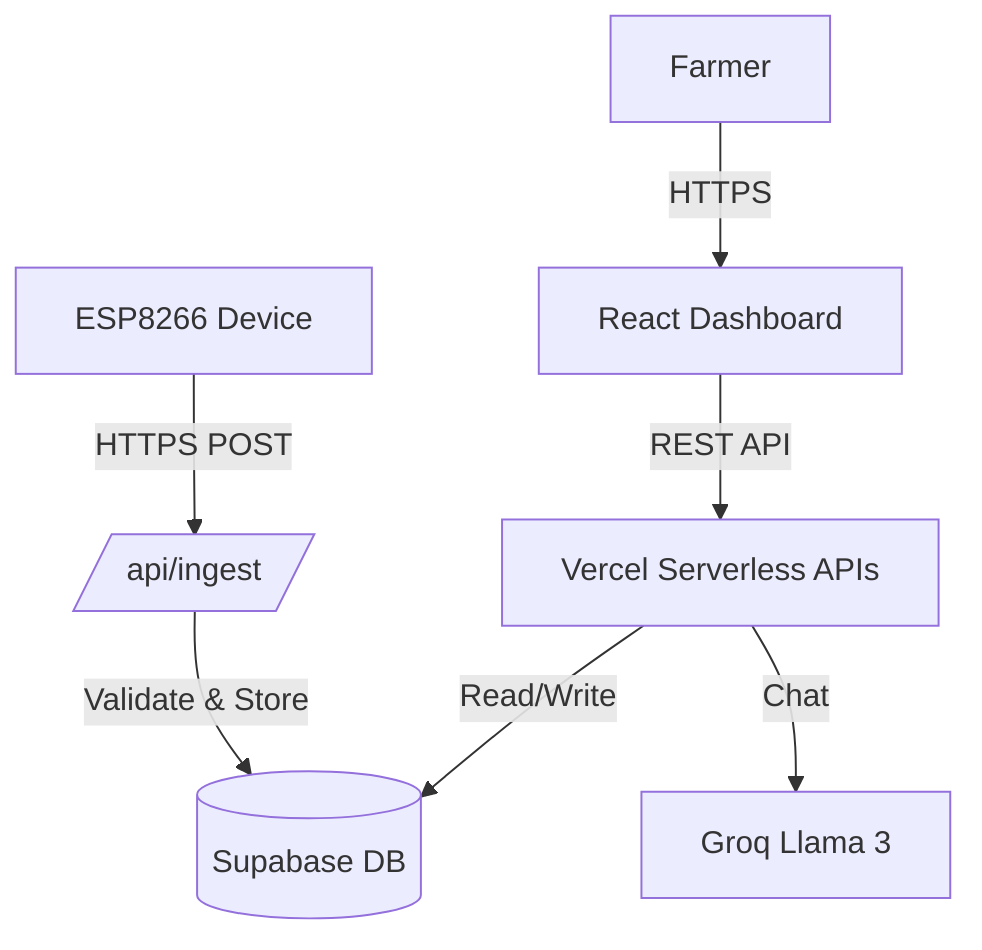

# FarmFlow Precision - AI-Driven Intelligent Irrigation System 🌾💧


FarmFlow is a precision agriculture platform that combines IoT sensor data, AI-driven weather analysis, and water budgeting to optimize irrigation. It features a modern React dashboard, serverless Python backend, and secure IoT integration.

---

## 🚀 Key Features

### 🧠 Intelligent Irrigation
- **Water Budgeting**: Tracks daily/seasonal water usage against borewell/tank capacity
- **AI Consultant**: Built-in LLM chat (Llama 3.3) for agronomy advice
- **Smart Recommendations**: Traffic-light system for irrigation decisions (Full/Partial/Skip)
- **Pump Safety**: Auto-shutoff for rain, max duration, or high moisture

### 📡 IoT Connectivity
- **ESP8266/ESP32 Integration**: Secure HTTPS data ingestion
- **Live Monitoring**: Real-time soil moisture visualization
- **Device Management**: Register/manage multiple sensors via dashboard
- **Fail-Safe Mode**: Manual overrides if sensors fail

### 💻 Modern Tech Stack
- **Frontend**: React, TypeScript, Vite, Tailwind CSS, Framer Motion
- **Backend**: Vercel Serverless Functions (Python)
- **Database**: Supabase (PostgreSQL + RLS Security)
- **Auth**: JWT-based secure authentication

---

## 🏗️ Architecture



### API Endpoints
| Method | Endpoint | Description |
|--------|----------|-------------|
| `POST` | `/api/register` | User registration |
| `POST` | `/api/login` | JWT login |
| `GET` | `/api/farm` | Fetch farm usage stats |
| `POST` | `/api/chat` | AI Agronomist chat |
| `POST` | `/api/ingest` | **IoT Data Ingestion** (Rate limited) |
| `GET` | `/api/devices` | List registered sensors |

---

## 🛠️ Setup & Deployment

### 1. Prerequisites
- Node.js 18+
- Python 3.9+
- Supabase Account
- Vercel Account
- Groq API Key (for AI chat)

### 2. Environment Variables (.env)
```env
# Backend (Vercel)
SUPABASE_URL=your_supabase_url
SUPABASE_ANON_KEY=your_supabase_anon_key
JWT_SECRET_KEY=your_secure_secret
GROQ_API_KEY=your_groq_key
ALLOWED_ORIGINS=https://your-app.vercel.app

# Frontend (.env.local)
VITE_API_URL=/api  # Points to Vercel functions
```

### 3. Database Setup (Supabase)
Run the SQL from `supabase_schema.sql` in your Supabase SQL Editor. This will create:
- `users`, `farm_settings`, `usage_logs`
- `devices`, `sensor_readings` (IoT)
- Row Level Security (RLS) policies

### 4. Running Locally
```bash
# Frontend
npm install
npm run dev

# Backend (requires Vercel CLI)
vercel dev
```

---

## 🔌 IoT Device Setup (ESP8266)

1. Go to **Device Settings** in the dashboard.
2. Click **Register Device**.
3. Copy the generated `deviceId` and `deviceSecret`.
4. Flash your ESP8266 with the following config:

```cpp
const char* ssid = "YOUR_WIFI";
const char* password = "YOUR_PASS";

// From FarmFlow Dashboard
const char* deviceId = "your-device-uuid";
const char* deviceSecret = "your-device-secret";
const char* ingestUrl = "https://your-app.vercel.app/api/ingest";
```

---

## 🔒 Security Measures
- **Rate Limiting**: IoT ingestion limited to 1 reading/5s per device
- **Input Validation**: Strict type & range checking (0-1023 moisture)
- **Device Secrets**: Secondary authentication token for sensors
- **Pump Safety**: 1-hour max run time + 15m cooldown
- **CORS**: Restricted to frontend domain

---

